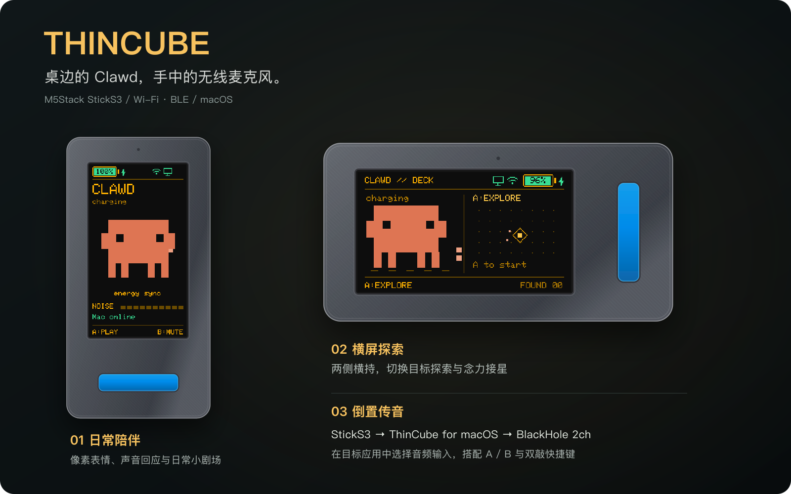
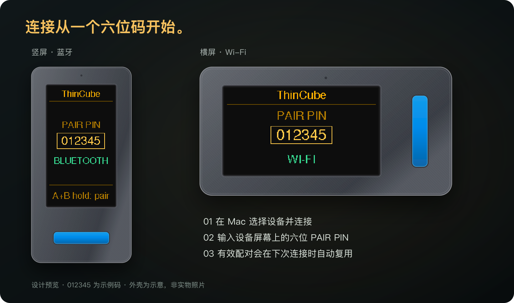
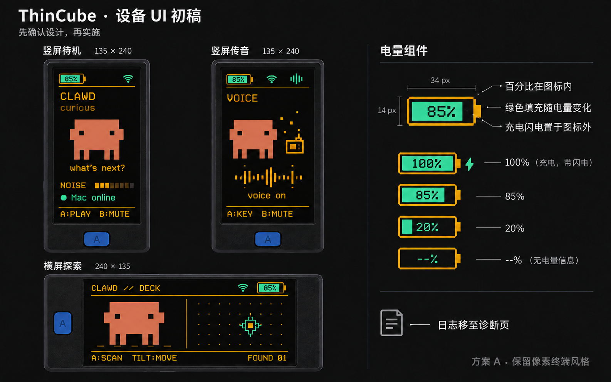

# ThinCube

ThinCube 是基于 M5Stack StickS3 的 Clawd 电子伙伴，搭配 macOS 上位机，提供无线麦克风、姿态互动与自定义快捷键。



*屏幕复用项目已有的固件画布，外壳为设计示意。Clawd 会回应声音、陪你探索；倒置设备后，还能把声音送到 Mac。*

当前源码版本：Mac **v0.4.38**，设备固件 **v0.4.74**，通信协议 **v1**。

[功能预览](#功能预览) · [快速开始](#快速开始) · [设备怎么用](#设备怎么用) · [开发](#开发) · [目录与文档](#目录与文档)

## 主要功能

- **Clawd 伙伴**：日常动画与音效、横屏探索和接星、朝下息屏与闲置休息。
- **无线连接**：Wi-Fi / BLE 切换、屏幕 PIN 配对、设备发现与自动重连。
- **语音输入**：校准后倒置进入对讲模式，经 Mac 和 BlackHole 2ch 提供音频输入，也可手动开始或停止。
- **快捷键**：对讲模式下 A/B 按住保持、松开释放；双敲执行独立快捷键的一次按下与松开。
- **设备管理**：亮度、输入增益、音效、静音、校准、恢复出厂设置、Mac Wi-Fi OTA 与手机热点升级。
- **自动休眠**：从最后一次活动起五分钟息屏，电池供电下十分钟深睡、二十分钟关机，无需设置。USB 供电时保持在线。

## 功能预览

### 连接与配对



设备显示六位 `PAIR PIN`，在 Mac 的配对窗口中输入即可完成应用授权。蓝牙可直接连接；Wi-Fi 需先配网，并与 Mac 处于同一局域网。有效配对会自动复用。图中 `012345` 为公开示例码，屏幕来自已采用的简洁配对布局重建。

### 界面设计稿

下面是项目早期制作的高保真方案，展示琥珀文字、绿色状态、像素 Clawd、悬浮对讲机和横屏探索的视觉方向。**其中的状态栏与按键文案属于历史设计，当前操作以[设备怎么用](#设备怎么用)为准**。



可在本地用浏览器打开[简洁配对交互稿](demo/pairing-simple.html)，切换方向、连接方式和预览倍率；[配对方案对比稿](demo/pairing-options.html)保留了此前的设计探索。素材来源与可编辑预览见[预览素材说明](docs/assets/readme/README.md)。

## 快速开始

需要一台 StickS3、一根支持数据传输的 USB 线，以及 macOS 13+ 的 Mac。建议先用蓝牙完成连接，再按需配置 Wi-Fi。

1. 构建并通过 USB 安装项目固件；首次安装或分区不兼容时需要写入项目的 bootloader、A/B 分区表及应用。
2. 首次开机短按 **A 选择蓝牙**，或 **B 选择 Wi-Fi**。Wi-Fi 模式按屏幕提示连接设备热点，访问 `http://192.168.4.1` 配置 2.4 GHz 网络。
3. 打开 `/Applications/ThinCube.app`，选择设备并连接，按提示输入设备屏幕上的六位配对码。若 macOS 弹出蓝牙配对确认，点击“配对”；Wi-Fi 模式下 Mac 与设备需在同一局域网。
4. 在“设备”页完成“竖向倒立，A 键在上”和“屏幕朝上平放”两项校准。
5. 安装 [BlackHole 2ch](https://github.com/ExistentialAudio/BlackHole)，在“声音”页点击“准备音频”，再在目标应用中选择 **BlackHole 2ch** 作为输入设备。
6. 在“声音”页开启“允许语音输入”。先屏幕朝上平放，再让屏幕面向自己、**A 键在上，显示屏在下**，倒立并稍作停稳，即可进入对讲模式。
7. 如需控制目标应用，在“按键”页录制或选择 A/B、双敲的快捷键，并在 macOS“系统设置 → 隐私与安全性 → 辅助功能”中开启 ThinCube。

语音发送到连接的 Mac，识别由接收音频的应用负责。连接、重新配对和恢复出厂操作见[连接与配对说明](docs/connection-pairing-v0.4.6.md)。

## 设备怎么用

**A 是正面屏幕下方的蓝色按键，B 是机身侧键。** 对讲机内外的按键用途不同；配对、配网和升级等系统页面以屏幕提示为准。

| 场景 | 操作 | 会发生什么 |
|---|---|---|
| 日常陪伴 | 正常竖持，短按 A | 与 Clawd 互动；开启本地声音互动后，它也会回应环境音量。 |
| 横屏探索 | 屏幕面向自己，横持且 A 在右，短按 A | 进入目标探索；左右倾斜、前后俯仰控制瞄准，靠近目标并停稳后自动扫描。 |
| 念力接星 | 屏幕面向自己，横持且 A 在左，短按 A | 开始一轮 20 秒接星；左右倾斜移动托盘。两种横屏玩法都可长按 A 约 1.2 秒退出。 |
| 姿态语音 | 校准并准备音频后，从屏幕朝上平放翻到倒立 | 开始向 Mac 传音；翻回正立、横持或朝上平放并停稳，退出姿态语音。 |
| 对讲快捷键 | 倒置对讲时，按住 A 或 B | 分别保持各自绑定的快捷键，松开释放；B 未绑定时不执行操作。松开快捷键不会停止传音。 |
| 独立双敲 | 倒置对讲时，双敲正面 A 键上方区域 | 执行双敲绑定的一次按下与松开。在“按键 → 敲击设置”调整后，点击“保存到设备”可在重启后保留。 |
| 普通模式静音 | 对讲机外短按 B | 切换设备麦克风静音；扬声器音效在 Mac“声音”页单独控制。对讲机内 B 使用快捷键功能。 |
| 切换连接 | 对讲机外长按 B 约 3 秒，随后松开 | 在 Wi-Fi 与蓝牙之间切换，设备记住所选方式。 |
| 重新配对 | 退出对讲并空闲时，同时按住 A+B 约 3 秒，再全部松开 | 进入重新配对流程，在 Mac 按提示完成授权。 |
| 手机升级 | 按住正面 A，再短按电源/复位键；保持按住等待大字 `2 → 1`，看到 `RELEASE A` 后松开 | 开启无需密码的临时升级热点，手机按屏幕热点名称和六位升级码操作。原配对、网络与校准保留。 |
| 暂时休息 | 屏幕朝下平放约 1.5 秒 | 空闲时息屏休息；缓慢翻起或拿起恢复显示。 |

Mac 客户端的常用入口：

| 页面 | 可以做什么 |
|---|---|
| **设备** | 连接、配对、姿态校准、亮度、休眠与 Wi-Fi 配置。 |
| **按键** | 设置 A/B 与双敲快捷键，调整敲击识别，查看按键诊断。 |
| **声音** | 准备 BlackHole 音频、允许语音输入、手动开始/停止持续语音，调整增益与扬声器。 |
| **固件** | Mac 通过 Wi-Fi 上传固件；或在蓝牙/Wi-Fi 连接下点“用手机升级…”开启设备热点。写入具体镜像均需接入外部电源、设备 A 确认，保守电量至少 50%。 |

手机先将 `thincube-<版本>.bin` 下载到本机文件，再连接无需密码的 `ThinCube-Update-xxxxxx` 热点，用完整 Safari/Chrome 打开 `http://192.168.4.1/`，输入设备屏幕六位升级码并选择固件。按设备 A 确认后等待写入校验完成；手机发送到 100% 时仍需等待最终结果。等待时 B 退出，上传时 B 先取消；失败可重试，闲置五分钟自动退出。升级或退出后设备恢复原蓝牙/Wi-Fi 模式。写入完成不代表升级已最终生效。重启后设备以琥珀色显示“SELF CHECK／DO NOT RESTART”，请保持供电约 60–90 秒，不要手动复位、关机或插拔 USB；只有健康检查通过并正式确认新版后，才会显示绿色“UPDATE COMPLETE”和版本号，短按 A/B 继续。手机热点会随重启断开，网页保留待自检提示，不会定时宣告成功；自检未确认前再次重启会自动回到旧版。Mac 发起后暂停重连，设备退出热点后可在“固件”页重新连接。v0.4.71 起，页面和设备共同阻止误装旧版，官方文件名必须与镜像内部版本一致；同版本重装仍允许。v0.4.73 起，必须接入 USB 电源且保守电量至少 50% 才能开始无线升级；充满后保持外部供电也可升级。页面自动刷新供电状态，未接电时禁用开始按钮；设备独立复查，确认或写入中检测到供电断开会中止且不启用新镜像。升级后自检完成前请保持 USB 连接。v0.4.74 完成页采用平滑圆环与圆角对钩，保持琥珀页眉和绿色完成状态。最新包见 `artifacts/phone-ota-v0.4.74/for-iphone/thincube-v0.4.74.bin`，视觉变更见[完成页 A 方案](docs/phone-hotspot-ota-v0.4.74.md)，实现与验证见[外部供电升级限制](docs/phone-hotspot-ota-v0.4.73.md)。诊断与修复见[误装旧版防护](docs/phone-hotspot-ota-v0.4.71.md)，自检提示见[英文升级结果提示](docs/phone-hotspot-ota-v0.4.70.md)，入口布局见[大字倒计时](docs/phone-hotspot-ota-v0.4.68.md)，完整操作见[手机热点升级](docs/phone-hotspot-ota-v0.4.66.md)。

遇到问题时，先检查下面几项：

- **连上了但没有声音**：确认“允许语音输入”已开、麦克风未静音、BlackHole 已就绪，且目标应用选对输入；也可在“声音”页手动“开始持续语音”排查。手动会话需点击“停止语音”结束。
- **倒立没有反应**：检查两项校准，先朝上平放再重新倒立。断线重连后也需要一次新的姿态转换。
- **快捷键没有反应**：确认辅助功能权限、对应绑定和当前对讲状态。敲击设置窗口打开时，双敲只记录，不发送快捷键。

需要恢复出厂时，按住 B 并单击电源/复位键，松开 B 后进入确认页：**A 确认清空设备全部配置，B 取消**。确认后需重新配网、配对和校准，详见[恢复出厂说明](docs/factory-reset-v0.4.38.md)。

## 开发

环境：StickS3、PlatformIO；Mac 端需要 macOS 13+、Xcode 命令行工具及 Swift 5.9+。固件依赖版本见 [platformio.ini](firmware/platformio.ini)。

```sh
# 构建固件并生成分发镜像、校验清单
pio run -d firmware -e m5stack-sticks3
python3 scripts/package-firmware.py

# 构建、签名并安装 Mac 应用
bash scripts/build-macos.sh

# 本地回归检查，不访问 USB、不烧录
bash scripts/test-local.sh
```

首次 USB 安装使用 `pio run -d firmware -e m5stack-sticks3 -t upload`；已有兼容 A/B 分区的设备可通过上位机执行 Wi-Fi OTA。

Mac 首次构建前需配置固定 Apple 签名身份，见[签名配置脚本](scripts/setup-macos-signing.sh)与[签名说明](docs/keychain-update-research.md)。构建脚本会替换 `/Applications/ThinCube.app`；本机启动、联调和系统授权统一使用此位置。已有构建可用 `bash scripts/install-macos.sh` 单独安装，仅生成分发产物时才使用 `--no-install`。

## 目录与文档

源码位于 `firmware/` 和 `macos/`，开发脚本位于 `scripts/`；`artifacts/` 保存本机构建产物和验证记录，不纳入 Git。

| 内容 | 文档 |
|---|---|
| 实施进展与验收范围 | [实施状态](docs/implementation-status.md) |
| 连接、配对与重设 | [连接与配对](docs/connection-pairing-v0.4.6.md)、[恢复出厂](docs/factory-reset-v0.4.38.md) |
| 通信、音频与升级 | [v1 协议](docs/thincube-protocol-v1.md)、[Wi-Fi / BLE 实现](docs/wifi-ble-implementation.md)、[手机热点升级](docs/phone-hotspot-ota-v0.4.71.md)、[历史配网与 OTA](docs/wifi-prov-ota.md) |
| 角色与玩法 | [Clawd 设计](docs/clawd-character-v2.md)、[横屏玩法](docs/landscape-exploration.md) |
| 快捷键与手势 | [A/B 快捷键](docs/walkie-b-shortcut-v0.4.41.md)、[双敲设置](docs/tap-settings-v0.4.28.md)、[设备保存](docs/tap-persistence-v0.4.57.md)、[按键诊断](docs/key-diagnostics-v0.4.26.md) |
| 省电与开发环境 | [统一休眠策略](docs/unified-sleep-v0.4.60.md)、[在线待机](docs/idle-power-v0.4.9.md)、[朝下息屏](docs/face-down-rest-v0.4.19.md)、[云端研发](docs/cloud-development.md) |

各版本的实现细节、测试数据和调研记录保存在 `docs/`。Wi-Fi 控制与音频目前使用局域网明文协议，应在可信网络使用；端到端时延、长时间稳定性及 OTA 异常回滚仍待完整实机验收。

## 固件备份

原厂整片备份保留 **2026-10-16 新设备原厂固件**及配套记录，详见[备份说明](firmware-backup/README.md)。老设备 2026-09-23 最初固件尚待找回。项目构建产物及后续升级前备份仅在本机 `artifacts/` 留存，不纳入 Git。
