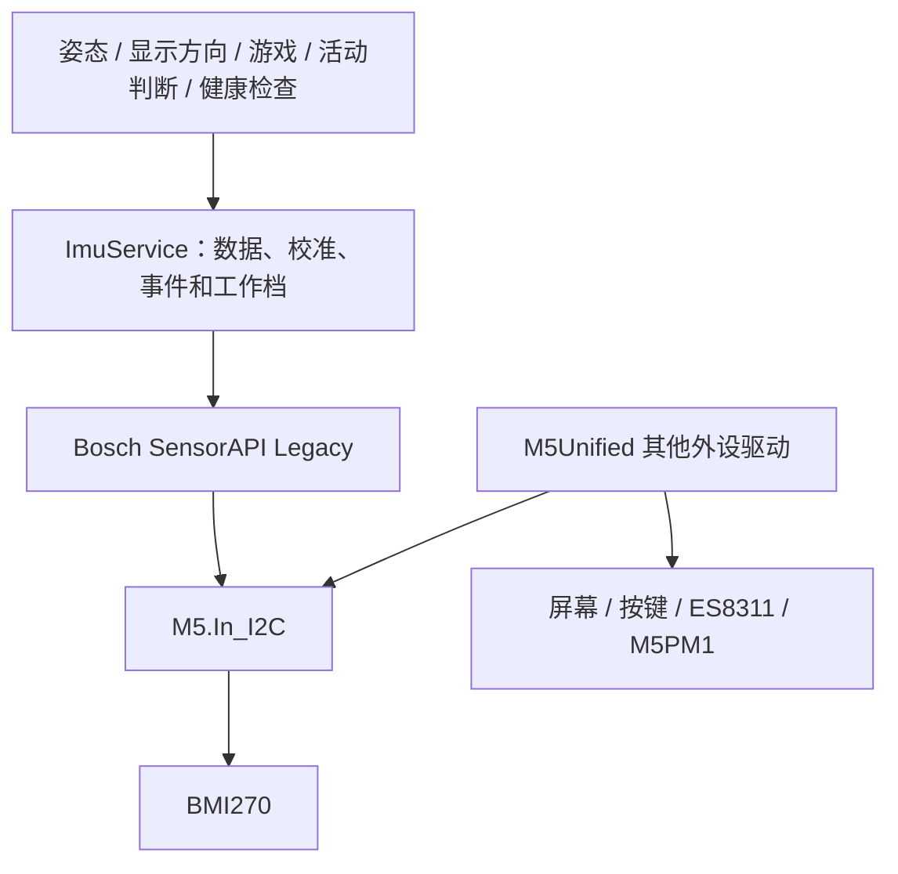

# BMI270 敲击驱动迁移方案与成本

日期：2026-10-18。目标：在 StickS3 上接入 BMI270 片上双敲识别，保持 ThinCube 的姿态、对讲机、游戏及运动唤醒功能。调研基线为当前工作区 v0.4.39 和固定 M5Unified `8b63555`；工作区已有未提交的姿态容错修改，本文不修改这些代码。本轮完成源码核查及临时驱动测试，没有迁移产品代码、构建安装应用、烧录或进行本机敲击实测。

## 决策摘要

**建议保留 M5Unified 的屏幕、音频、电源、按键和 I²C，只将 IMU 子系统接到 Bosch 官方 SensorAPI 的 Legacy 配置，增加项目自己的 `ImuService` 作为唯一入口。** 不必更换硬件或整套开发框架。Bosch 官方提供 Legacy 单/双/三敲能力与示例；现有芯片可以运行这套配置。[官方功能清单](https://github.com/boschsensortec/BMI270_SensorAPI/blob/41129fcfe39c583ee5462d79195741945d51c1fe/README.md)、[tap 示例](https://github.com/boschsensortec/BMI270_SensorAPI/blob/41129fcfe39c583ee5462d79195741945d51c1fe/bmi270_legacy_examples/tap/tap.c)

第一版只开放**有效对讲机状态下的机身双敲**。先做诊断计数，验证轻敲与正常按键、拾放、桌面碰撞可区分，再接快捷键。单敲、三敲、桌面远距离敲击、深睡双敲唤醒和常驻全场景遥控不纳入首版。

工程估算：实验原型约 **1–2 人日**；含兼容、深睡与回退验证的驱动迁移约 **4–7 人日**；再包括新输入协议与 Mac 映射约 **6–10 人日**。均按一位熟悉本仓库的开发者、每天约 8 小时有效工作估算，原型包含在完整迁移内，三项不是相加。需要有设备可供多轮验证；这不是已经测得的工时，也不保证敲击手感一定达到产品要求。

## 1. 路线选择

| 路线 | 能得到什么 | 初始/长期代价 | 判断 |
| --- | --- | --- | --- |
| 修改 M5Unified 的 BMI270 blob，再手写 Legacy feature 寄存器 | 保留 `M5.Imu` 调用形式 | 初始改动较少；仍须修改深睡、tap 页操作、事件读取和所有重新初始化路径，且要维护固定依赖补丁 | 可用于短期实验，不作为首选维护路线 |
| Bosch Legacy + 项目 `ImuService`；M5Unified 继续管理其他外设 | 使用官方配置/feature API，IMU 生命周期和故障处理集中 | 增加一层适配，迁移约五个现有 `.cpp` 的直接调用，需明确兼容坐标/偏置 | **推荐** |
| 换成第三方 Arduino BMI270 封装 | Arduino 风格接口 | 必须核对其实际加载配置与总线所有权；库名称相同不代表支持 Legacy tap | 没有发现比官方 C API 更直接的现成迁移路径 |
| 同时运行 M5Unified IMU 与另一个驱动 | 表面上可少改现有调用 | 初始化会互相重置配置，状态读取也可能清掉另一方的事件 | 不采用 |

固定 M5Unified 已提供 `cfg.internal_imu=false` 和 `external_imu=false`，以及可复用的 `M5.In_I2C`；`IMU_Class` 暂无公共接口注入另一枚自定义 IMU 实例。因此独立服务可通过公共配置关闭旧 IMU，无需修改依赖私有成员。[配置接口](https://github.com/m5stack/M5Unified/blob/8b63555e7bd9ac71978c55ad868fd1d1d3b2ef3e/src/M5Unified.hpp)、[IMU 接口](https://github.com/m5stack/M5Unified/blob/8b63555e7bd9ac71978c55ad868fd1d1d3b2ef3e/src/utility/IMU_Class.hpp)、[I²C 接口](https://github.com/m5stack/M5Unified/blob/8b63555e7bd9ac71978c55ad868fd1d1d3b2ef3e/src/utility/I2C_Class.hpp)

第三方抽查：SparkFun 当前主分支的头文件引用 base `bmi270.h`，初始化调用 `bmi270_init()`；直接安装该库不会自动成为 Legacy tap 驱动。这只说明抽查版本的默认路径，不宣称所有第三方库都不支持敲击。[SparkFun 头文件](https://github.com/sparkfun/SparkFun_BMI270_Arduino_Library/blob/main/src/SparkFun_BMI270_Arduino_Library.h)、[初始化实现](https://github.com/sparkfun/SparkFun_BMI270_Arduino_Library/blob/main/src/SparkFun_BMI270_Arduino_Library.cpp)

## 2. 推荐架构与初始化

初始化建议：

1. 保持现有总线恢复与板型检测，关闭 M5Unified 内、外 IMU 自动初始化。现有 `if (!M5.Imu.isEnabled()) M5.Imu.begin()` 也必须迁走。
2. 复用 `M5.In_I2C`，为 Bosch 提供带错误返回的 read/write、微秒延迟和实例上下文；不另行 `Wire.begin()` 重配共享总线。地址使用 StickS3 的 0x68，确认 `CHIP_ID=0x24`；传输长度遵守实际总线及 API 限制。
3. 清理 PM1 的旧唤醒/HOLD 状态，执行 `bmi270_legacy_init()`，检查返回值及 `INTERNAL_STATUS`；显式配置加速度、陀螺仪、量程和滤波，不依赖演示代码的隐式默认值。
4. 建立缓存、各传感器新样本标志和时间；取得新鲜有效数据后才报告 IMU 就绪，旧数据不能因“成功调用函数”反复续命。
5. 首先关闭 tap，恢复原始姿态行为；完成兼容验证后，再按用户设置开启双敲。

Bosch 只引入选定的 `bmi2.c/.h`、`bmi2_defs.h`、`bmi270_legacy.c/.h` 与许可证，固定提交并记录最小补丁。不把 PC 示例的 `main()`、COINES 硬件平台代码引入产品。

## 3. 需要迁移的本仓库位置

| 位置 | 当前依赖 | 迁移内容 |
| --- | --- | --- |
| [main.cpp](../firmware/src/main.cpp) | M5 自动/显式 IMU 初始化及串口状态 | 关闭旧初始化，调用服务并报告 backend/config/错误 |
| [motion.cpp](../firmware/src/motion.cpp) | `update/getImuData/isEnabled` | 改读服务快照，保留 `deviceMotion`、活动与动画输入；tap 事件与原始数据分发分别处理 |
| [device.cpp](../firmware/src/device.cpp) | 姿态校准直接读取 `M5.Imu` | 从同一份新鲜服务缓存校准，保持 `upright/faceup` 设置含义 |
| [ota.cpp](../firmware/src/ota.cpp) | `otaMarkValid()` 要求 `M5.Imu.isEnabled()` | 改为服务实际健康；漏改会导致旧 IMU 关闭后，新固件始终不能确认升级成功 |
| [deep_sleep.cpp](../firmware/src/deep_sleep.cpp) | 底层实例指针、类型及失败后的 `M5.Imu.begin()` | 将睡前配置、回滚和重新初始化交给服务；重新初始化不得偷偷载回 base blob |
| [motion_wake_registers.h](../firmware/src/motion_wake_registers.h) | 写死 base page1 的 4 字节布局及映射 | 按 Legacy 定义实现独立事务，保持 PM1 切电前的验证和失败恢复 |
| [motion_wake_test.cpp](../firmware/test/motion_wake_test.cpp) 等 | 模拟 base feature 地址及故障 | 加 Legacy 页模型、tap 状态、健康及故障测试，保留现有姿态与电源回归 |
| [platformio.ini](../firmware/platformio.ini) / 第三方目录 | 当前固定 M5Unified | 引入固定 Bosch 子集、补丁及许可；不直接编辑 `.pio/libdeps` 缓存 |

这些是源码搜索确认的调用边界；原始姿态、对讲机退出容错、横屏玩法和音频编解码不需要借此重新设计。当前 v0.4.39 的退出容错修改须一起回归，不能按早期姿态阈值验收。[当前姿态容错记录](walkie-pose-hysteresis-v0.4.39.md)

## 4. 兼容成本最高的三个部分

### 坐标、单位与已有校准

M5Unified 对 StickS3 做了板轴转换 `X=传感器+Y，Y=传感器−X，Z=传感器+Z`，输出 g 和 °/s；它还在转换前减去自身 NVS 中的 raw 16.16 偏置。项目另存的 `upright/faceup` 是姿态方向符号，两种校准不能混为一谈。[原转换与 NVS 实现](https://github.com/m5stack/M5Unified/blob/8b63555e7bd9ac71978c55ad868fd1d1d3b2ef3e/src/utility/IMU_Class.inl)

Bosch 高层 sensor-data 路径还会做 gyro 交叉轴修正和轴映射。为降低迁移差异，首版建议由服务通过官方寄存器读接口取得原始数据，沿用旧量程换算、偏置顺序及板轴转换；Bosch 负责初始化、feature 与电源配置。片上映射保持 identity，双敲先试 sensor Z（与板 Z 相同）。若以后启用 Bosch 高层校正，应作为明确的校准行为变更验证，不能再次套同一板轴变换。[官方数据处理](https://github.com/boschsensortec/BMI270_SensorAPI/blob/41129fcfe39c583ee5462d79195741945d51c1fe/bmi2.c)

旧校准只读兼容，不因切换驱动清空 NVS、配对或 Wi-Fi。无旧偏置时也要有明确的零偏/静置标定规则。对比静态六面和绕三轴转动，确认符号、单位、偏置处理和新鲜度，再恢复实际语音姿态逻辑。

### 事件统一消费

Legacy tap 可以通过 I²C 轮询状态及结果，官方示例就是轮询；首版不需要把 PM1 IRQ 接进在线事件分发。芯片内部做敲击判定，MCU 不必保存全部 200 Hz 波形才能取得敲击结果。[官方示例](https://github.com/boschsensortec/BMI270_SensorAPI/blob/41129fcfe39c583ee5462d79195741945d51c1fe/bmi270_legacy_examples/tap/tap.c)

但 `bmi2_get_int_status()` 会读两个状态字节，状态读取会清标志；如果旧 `M5.Imu.update()` 同时消费 data-ready，就会产生竞争。因此原始数据就绪、tap 状态、睡眠清事件都由服务统一消费。敲击结果不是无限队列：忙碌阻塞太久会合并/漏掉事件，必须记录最大轮询间隔，事件到达后立即读结果，再生成自己的序号和有界队列。在线识别可先用约 10–20 ms 的轮询目标，实际最坏时延仍需测量。[官方状态读取](https://github.com/boschsensortec/BMI270_SensorAPI/blob/41129fcfe39c583ee5462d79195741945d51c1fe/bmi2.c)、[Legacy 寄存器说明](https://www.bosch-sensortec.com/media/boschsensortec/downloads/application_notes_1/bst-bmi270-an002-01.pdf)

### 深睡唤醒和失败恢复

现有睡前流程以 base ANY_MOTION page1 offset0x0C 为依据；Legacy ANY_MOTION 在 page1 offset0x06，且 enable/out_conf 布局不同。不能只改一个地址、复用原四字节常量。普通状态读回也无法验证“当前加载的是哪种镜像”；配置身份应由服务控制并记录。[base 实现](../firmware/src/motion_wake_registers.h)、[Legacy feature 定义](https://github.com/boschsensortec/BMI270_SensorAPI/blob/41129fcfe39c583ee5462d79195741945d51c1fe/bmi270_legacy.h)

采用**一次启动加载 Legacy，再切换工作参数**的路线，语音开启/关闭时不重载不同 blob。睡前先关 tap、清状态，按 Legacy 配置低功耗 any-motion，关 gyro，完成 PM1 GPIO4 唤醒及 LDO/HOLD 配置，复查中断线与芯片状态后才切电。失败时逐项恢复普通模式，不能重新调用旧 IMU 初始化。醒来清掉旧事件并重新武装；唤醒动作不补发快捷键。

## 5. 双敲原型的具体选择

- 仅启用 double tap，不绑定 single/triple。先提供检测计数与最后一次参数/拦截原因，不自动发送系统快捷键。
- 用户数据 tap 路径要求加速度 ODR=200 Hz；内部数据路径使用内部 200 Hz，功耗模式另有条件。原型先显式用合法的 200 Hz 正常模式，保持 ±8g、gyro ±2000°/s 作为兼容起点；后续再比较内部数据路径能否维持旧应用采样配置。[Legacy tap 条件](https://www.bosch-sensortec.com/media/boschsensortec/downloads/application_notes_1/bst-bmi270-an002-01.pdf)
- 首轮从约 300–400 ms 的动作窗口、明确的手势后安静期、等待窗口分类开始试验；全部值显式配置和回读。它会带来判定等待，不能宣称第二下敲击瞬间就无延迟执行。
- 按键触碰附近、会话变更、配网/OTA、游戏、校准、休息和睡眠准备期间抑制或关闭 tap；进入有效语音后停稳再武装，避免开关模式或拾起动作被当作敲击。tap 触发后再核对当前会话并去重。
- 同一 Legacy 内设置普通、敲击、睡眠三个参数档。睡眠档关闭 tap，保留运动唤醒；档位切换只由主循环所有者执行，不在音频回调操作 feature 页。

上述时序和参数是原型建议。芯片片上识别并不解决机壳传振、敲击噪声进麦克风或桌面误触，这些决定功能能否产品化。

## 6. 已发现的依赖问题与资源成本

固定 Bosch 提交 `41129fc…` 的 `set_config_page_primary()` 存在循环边界问题：16 字节 `feat_config` 被 `index <= idx` 在末尾多访问一字节。本轮将实际 `bmi270_legacy.c + bmi2.c` 接到模拟页寄存器，在 Mac 上用 ASan/UBSan 复现；临时将边界改为 `<` 后通过，并核对只有预期 tap 页字段改变。**这是主机内存测试结果，不是设备故障实测。** 迁移时应提交一个明确的最小 vendor 补丁及回归，而非无记录修改依赖缓存。[固定问题位置](https://github.com/boschsensortec/BMI270_SensorAPI/blob/41129fcfe39c583ee5462d79195741945d51c1fe/bmi270_legacy.c#L2639)、[详细证据](bmi270-legacy-driver-evidence-2026-10-18.md)

| 成本 | 本轮能确认的范围 |
| --- | --- |
| 硬件/物料 | 沿用 BMI270 与现有 I²C，无新增器件或改线需求 |
| Flash | 当前 v0.4.39 镜像 1,751,200 B，2 MiB 槽剩 345,952 B（约 338 KiB）。临时 S3 交叉编译两个官方 C 文件的未链接 text 合计 35,456 B（约 34.6 KiB，含 Legacy 8192 B blob）；这是预算参考，最终增量受裁剪、LTO、旧驱动及回退路径影响 |
| RAM/栈 | S3 ABI 的 `bmi2_dev` 为 112 B，tap 参数为 16 B；blob 应驻 Flash，不按 8 KiB 常驻 RAM 预算。局部缓冲、任务栈、队列与最小空闲内部内存须在真实镜像和音频并发下测量 |
| 启动/切换 | 启动要上传配置并等待初始化；目前旧驱动也有上传。新增耗时需测量；运行中只改工作档，不重载 blob |
| 功耗 | tap 活动档有传感器算法与轮询开销。芯片手册电流不能替代整机续航；用关闭/启用 tap 的同条件对照测量，不预报续航减少百分比 |
| 维护 | 固定 Bosch 源码子集、最小补丁与适配层；未来升级依赖重跑初始化、tap 配置及睡眠事务回归 |
| 许可材料 | Bosch 源码标注 BSD-3-Clause，随引入保留 LICENSE/版权及分发材料中的对应说明；以实际所引入文件许可为准 |

镜像数字来自现有 [v0.4.39 构建记录](walkie-pose-hysteresis-v0.4.39.md)及本地已生成的 manifest，本轮未重建产品。对象体积与结构大小的命令、工具链边界及官方许可来源见[补充证据](bmi270-legacy-driver-evidence-2026-10-18.md)。

## 7. 迁移计划及工作量

下表为完整驱动迁移的工程估算，阶段有顺序依赖；原型在阶段 2/3 交界处可交付。每阶段同时产出必要的对照数据，不以“读到一个双敲事件”代替全部兼容验收。

| 阶段 | 工作与交付 | 工作量 | 通过门槛 |
| --- | --- | --- | --- |
| 1 基线与适配边界 | 保存旧数据样例、构建/内存基线；定义服务数据与健康接口、校准兼容和工作档 | 0.5–1 人日 | 完整列出初始化、OTA、校准及睡眠调用；原偏置/轴方向有对照 |
| 2 驱动接入 | 固定官方子集、修复并测试越界；总线回调、Legacy 初始化、原始数据与配置读回 | 0.75–1.25 人日 | 冷启动/重置可靠；六面和三轴转动与旧语义一致，无双驱动竞争 |
| 3 双敲诊断 | 配置双敲、轮询/去重/日志、工作档和负样本，先不接 Mac 注入 | 0.5–1 人日 | 能稳定识别有意双敲，参数可回读，按键/拾放不会明显误触 |
| 4 深睡与恢复 | Legacy any-motion/PM1 事务、取消/故障恢复、统一重初始化、基础回退 | 1–2 人日 | 不使用 base 地址；每个失败点不误切电，取消后 raw/gyro/tap 恢复 |
| 5 回归与发布准备 | 姿态/游戏/休息/OTA、Wi-Fi/BLE 音频并发，镜像/栈/电流、物理唤醒验证 | 0.75–1.75 人日 | 通过现有与新增必要检查；明确敲击误触/延迟和省电结果 |

合计约 **3.5–7 人日，排期按 4–7 人日**。原型 **1–2 人日** 指尽快验证“这台机壳上的双敲有没有继续投入的价值”，可以暂不开放深睡、不接快捷键；原型不可作为正式替代固件交付。

若加入上位机快捷键，额外约 **2–3 人日**：新增带来源的可靠输入和能力协商、`double_tap` 绑定与单次注入、旧客户端兼容、断线/编辑/锁屏释放及现场目标应用验证；完整排期约 **6–10 人日**。这部分不能把敲击伪装为旧 A 的 `edge`，否则旧 Mac 会错误执行 A 绑定。[前一轮输入协议方案](walkie-shortcut-input-research-2026-10-18.md)

估算不包含长时间续航放电或大量机壳/人群标定。若原型暴露需要接 PM1 在线 IRQ 或改变校准算法，建议另外预留 1–3 人日；若机壳负样本始终不可分，应按下面门槛停止，而非把调参当成有确定上限的工作。

## 8. 继续/停止门槛与回退

建议先投入原型，只有以下问题得到肯定结果才继续产品化：

1. 选定至少一种自然握持与敲击位置，重复轻敲约 30 组，命中率以 ≥95% 为原型目标；单敲、三连敲、放下、按 A/B、USB 线牵引、桌振要分别看负样本，不能靠提高灵敏度换取大量误触。
2. 测量完整动作到识别、识别到日志/系统事件的延迟；窗口分类的等待是否可接受。实际说话时敲击噪声是否影响用途，由现场体验判断。
3. 以必要的短时日常负样本观察作为继续门槛，例如 30 分钟无误触，并记录每种场景；它不证明长期可靠性。若机壳信号分不开，先调整敲击位置/轴和参数，仍不成立则停止这一路线。

发布前单独验证：

- 坐标/旧校准、v0.4.39 语音退出容错、显示旋转、两种横屏游戏、朝下息屏/翻起和 A 键保持均通过。
- tap 活动时 Wi-Fi/BLE 音频队列与控制租约正常；系统事件按来源去重，长时间阻塞后不补发过时动作。
- 对 Legacy 初始化/配置失败、I²C 读写失败、异常状态及睡眠准备每一步故障注入；不以陈旧缓存通过 OTA 健康确认。驱动必须可识别“姿态可用但 tap 不可用”。
- 深睡/拿起唤醒、准备取消、失败回滚、唤醒后重连与再次敲击；启动/唤醒事件不注入快捷键。
- 正式编译后核实 app 槽大小、map 中 blob 所在区域、最小内部堆与任务栈；对照测额外电流和初始化时间。

保留原 base 构建配置及已知可启动镜像用于回退。若实现同镜像自动降级，必须先停用 Legacy、复位芯片，再让 base 接管，且清空事件/会话、显式报告 tap 不可用；睡眠分支按当前 backend 选择，不能对 base 执行 Legacy 页写入。为降低首版复杂度，可以先采用独立 base/Legacy 构建与既有 OTA 回滚，不在语音会话中自动热切驱动。

本方案不要求清空配对、Wi-Fi、校准或重写 bootloader/分区。将来若修改 Mac 并重新构建，按仓库要求使用 `scripts/build-macos.sh`，安装和联调固定在 `/Applications/ThinCube.app`。本轮未执行这些部署动作。
