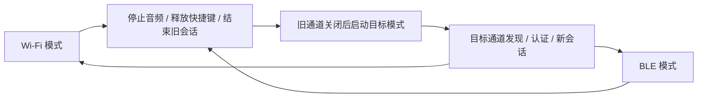

# ThinCube：Wi-Fi 与 BLE 互斥模式切换可行性调研

调研日期：2026-10-08。范围：StickS3 K150、现有 v0.3.10 固件与 v0.3.11 macOS 上位机。已按用户澄清修订：同一时刻只有一种连接在线，支持 Wi-Fi / BLE 模式切换。此次只核对官方资料、项目源码、已安装 SDK 和已有日志，没有修改或烧录固件，没有进行 BLE 真机测试。

## 结论

**同一套固件提供 Wi-Fi 和 BLE 两种模式，同一时刻只保留一种连接，并在两者间切换，技术上可行。** ESP32-S3 具备两种无线能力；当前 SDK 提供 Wi-Fi 停止/释放接口及 BLE 控制器生命周期接口，能够据此设计互斥的模式管理。切换可靠性仍需在现有 Arduino 框架与设备上实测。[Espressif：BLE Introduction](https://docs.espressif.com/projects/esp-idf/en/stable/esp32s3/api-guides/ble/overview.html)、[ESP-IDF 4.4.7：Wi-Fi](https://docs.espressif.com/projects/esp-idf/en/v4.4.7/esp32s3/api-reference/network/esp_wifi.html)、[ESP-IDF 4.4.7：Bluetooth Controller](https://docs.espressif.com/projects/esp-idf/en/v4.4.7/esp32s3/api-reference/bluetooth/controller_vhci.html)

**建议以“先断开旧连接，再建立新连接”的手动切换为基础，未选中的无线服务保持关闭。** Wi-Fi 模式保留现有控制、音频和 OTA；BLE 模式独立提供控制。若 BLE 模式也需要麦克风传音，必须在 BLE 上实现独立音频协议与 Mac 接收路径，并验证降采样或压缩方案。BLE 控制搭配 Wi-Fi 传音不符合本次互斥模式目标。

用户已向制造商确认该设备支持 BLE，这是本次调研的板级前提，未取得可公开引用的厂家答复原文。M5Stack 官方产品页确认主控为 ESP32-S3-PICO-1-N8R8；Espressif 官方文档确认 ESP32-S3 支持 BLE。因此，先前根据产品页没有列出蓝牙而排除 BLE 的判断应予更正；产品页未列出某功能不能证明其不存在。[M5Stack：StickS3](https://docs.m5stack.com/en/core/StickS3)、[Espressif：BLE Introduction](https://docs.espressif.com/projects/esp-idf/en/stable/esp32s3/api-guides/ble/overview.html)

> 2026-10-09 实施更新：已选定短重启、由 Mac 或单独长按 B 3 秒松手切换、目标 60 秒未确认自动回退；空闲 A+B 3 秒松开重新配对。完整实现、当前验证状态与协议见 [Wi-Fi / BLE 实现](wifi-ble-implementation.md)。下文资源数值属于调研时快照。

## 1. 已确认的目标与功能边界

以下是本次模式约束与可行性判断，尚不是已实现的产品能力。用户未要求切换时音频连续、零中断，也未指定是否允许设备重启；因此本报告同时区分短重启与不重启两条实现路径。

| 模式或操作 | 连接约束 | 对 ThinCube 的意义 |
|---|---|---|
| Wi-Fi 模式 | 仅 Wi-Fi 连接上位机 | 保留 HTTP / WebSocket、UDP 音频和现有 OTA |
| BLE 模式 | 仅 BLE 连接上位机 | 控制、设置与状态可行；音频需单独验证；不能暗中使用 Wi-Fi 传音 |
| 切换中 | 允许短暂无连接；旧连接结束后才建立新连接 | 先停止音频并释放快捷键，再清理旧通道、启动目标通道 |

**“两种连接可切换”与“两种模式所有功能完全相同”需分开验收。** 前者可确定进入设计；后者涉及 BLE 音频吞吐和 BLE OTA，仍需原型验证，不能因采用互斥模式就直接保证。

## 2. 官方硬件与模式生命周期边界

ESP32-S3 支持 BLE；其官方 Bluedroid/NimBLE 栈不支持经典蓝牙。当前官方支持矩阵中，S3 的 ESP-BLE-ISO、ESP-BLE-AUDIO 均未支持。因而不能把“支持 BLE”解释为可直接用经典蓝牙 SPP、HFP，或原生 LE Audio 实现系统蓝牙麦克风。[Espressif：BLE Introduction](https://docs.espressif.com/projects/esp-idf/en/stable/esp32s3/api-guides/ble/overview.html)

建议进一步把互斥连接实现为互斥无线服务：Wi-Fi 模式关闭 BLE 广播和连接，BLE 模式关闭 Wi-Fi STA、热点和自动重连。这样在设备侧避免两种无线业务争用射频；Mac 自身无线环境和 BLE 协议开销仍然存在。相较双连接方案，资源管理更简单，但节省多少内存和电量需要实测。

官方 `esp_wifi_stop()` 用于停止 Wi-Fi，`esp_wifi_deinit()` 释放初始化分配的资源并停止任务。互斥模式应通过统一状态机控制驱动与服务，防止 Wi-Fi 自动重连、热点配网或后台服务绕过模式选择。[ESP-IDF 4.4.7：Wi-Fi](https://docs.espressif.com/projects/esp-idf/en/v4.4.7/esp32s3/api-reference/network/esp_wifi.html)

BLE 有一项切换限制：`esp_bt_controller_mem_release()` / `esp_bt_mem_release()` 释放对应蓝牙内存后，本次启动周期内不能再次使用被释放的模式。当前 Arduino 2.0.17 的 `BLEDevice::deinit(true)` 会进入内存释放路径，因此不能把它当作可以反复开启 BLE 的普通关闭操作。若要求不重启切换，应避免该不可逆释放，验证停止/反初始化/重新初始化以及 GATT 对象清理；若采用模式切换后重启，则由新的启动周期初始化目标模式。[ESP-IDF 4.4.7：Bluetooth Controller](https://docs.espressif.com/projects/esp-idf/en/v4.4.7/esp32s3/api-reference/bluetooth/controller_vhci.html)、[Arduino ESP32 2.0.17：BLEDevice.cpp](https://github.com/espressif/arduino-esp32/blob/2.0.17/libraries/BLE/src/BLEDevice.cpp)

## 3. 当前项目已经具备什么，还缺什么

### 3.1 已安装工具链具备 BLE 基础

项目固定 `espressif32@6.12.0`，本机已安装 Arduino ESP32 2.0.17 / ESP-IDF 4.4.7。检查项目使用的 `qio_opi` SDK 配置，可见以下选项已经启用：

```text
CONFIG_BT_ENABLED=1
CONFIG_BT_BLUEDROID_ENABLED=1
CONFIG_BT_BLE_ENABLED=1
CONFIG_BT_GATTS_ENABLE=1
CONFIG_ESP32_WIFI_SW_COEXIST_ENABLE=1
```

Arduino 框架也带有 `libraries/BLE`，对应版本的官方示例提供 GATT Write / Notify 通信起点。这说明无需因为增加 BLE 就预先假定必须升级整套 SDK，但不代表当前固件已经启动 BLE 服务。[Arduino ESP32 2.0.17：BLE UART 示例](https://github.com/espressif/arduino-esp32/blob/2.0.17/libraries/BLE/examples/BLE_uart/BLE_uart.ino)

本地核查位置：`firmware/platformio.ini`；`/Users/numbero/.platformio/packages/framework-arduinoespressif32/package.json`；同框架 `tools/sdk/esp32s3/qio_opi/include/sdkconfig.h` 与 `include/esp_common/include/esp_idf_version.h`。旧版共存配置的公开来源：[ESP-IDF v4.4.7 Wi-Fi Kconfig](https://github.com/espressif/esp-idf/blob/v4.4.7/components/esp_wifi/Kconfig)。新版文档中的 `CONFIG_ESP_COEX_SW_COEXIST_ENABLE` 名称不能直接套到当前旧版框架。

当前预编译 SDK 选用 Bluedroid，没有启用 ESP-IDF NimBLE。Espressif 官方指出 NimBLE 占用更少的堆和 Flash，可以作为资源不足时的候选；切换需验证当前框架的集成方式和兼容版本，不能只在 PlatformIO 中添加一个宏就视为完成。[Espressif：BLE Introduction](https://docs.espressif.com/projects/esp-idf/en/stable/esp32s3/api-guides/ble/overview.html)

### 3.2 当前业务与 Wi-Fi 有多处耦合

以下均为当前源码事实：

| 位置 | 现状 | 双模式切换需要的调整 |
|---|---|---|
| `firmware/src/device.cpp:137`、`:283` | 控制所有者是 WebSocket socket fd，音频地址从 TCP 对端提取 | 统一会话与传输接口，每次只使用当前模式的控制与音频路径 |
| `firmware/src/device.cpp:322` | Wi-Fi 掉线直接使语音 peer 无效 | 分开判断控制在线、音频通道就绪与 Wi-Fi 状态 |
| `firmware/src/device.cpp:343` | 音频固定封装为 UDP 包 | 如做 BLE 音频，需独立封包和发送队列 |
| `firmware/src/voice_state.h:42`、`macos/Sources/ThinCube/DeviceModel.swift:241` | A 键快捷键要求已处于传音状态 | 若 BLE 无音频也允许快捷键，应明确新增行为并拆开条件 |
| `firmware/src/main.cpp:80`、`:102` | 无 Wi-Fi 凭据时进入热点配网；配网时业务 busy | BLE 独立使用需要自己的启动模式，不能一直被配网阻塞 |
| `firmware/src/device.cpp:268`、`firmware/src/ota.cpp:151` | 启动健康检查依赖 Wi-Fi 运行时服务注册 | BLE 独立启动须调整健康判据，避免新 OTA 固件在无 Wi-Fi 时被判不健康 |
| `macos/Sources/ThinCube/Discovery.swift`、`DeviceModel.swift` | Bonjour 发现，URLSession HTTP / WebSocket 控制 | 新增 BLE 发现、认证、消息传输，并共用业务入口 |

可复用设置、姿态校准、按键边沿去重、会话失效处理等业务逻辑，但需先抽离传输依赖。当前 100 ms 心跳、Mac 400 ms 释放快捷键、2 秒断开、设备 1 秒控制租约等规则，也要在 BLE 模式和模式切换时验证，不能未经测试直接宣称体验一致。[项目协议](thincube-protocol-v1.md)

### 3.3 Mac 原生支持所需接口

Mac 可以作为 BLE Central，由 StickS3 作为 GATT Peripheral。Apple 的 `CBCentralManager` 提供扫描、发现和连接能力；本机 SDK 头文件确认所需基本接口早于项目最低 macOS 13 可用。[Apple：CBCentralManager](https://developer.apple.com/documentation/corebluetooth/cbcentralmanager)

Mac 应补充 `NSBluetoothAlwaysUsageDescription`、处理蓝牙关闭/拒绝授权/断线。当前 `macos/Info.plist` 仅配置了局域网权限；构建脚本为 ad-hoc 签名，没有配置 App Sandbox。如果未来启用 App Sandbox，再按 Apple 要求添加 Bluetooth entitlement。[Apple：Protected resources](https://developer.apple.com/documentation/bundleresources/protected-resources)、[Apple：Bluetooth entitlement](https://developer.apple.com/documentation/bundleresources/entitlements/com.apple.security.device.bluetooth)

写入长度应读取 `maximumWriteValueLength(for:)`，无响应写入需处理 `canSendWriteWithoutResponse` 流控；设备上行通知则按设备实际协商的 ATT MTU 分片。不能把 Mac 的写入长度 API 当作设备通知长度，也不能假定所有 Mac 都协商到同一个值。[Apple：maximumWriteValueLength](https://developer.apple.com/documentation/corebluetooth/cbperipheral/maximumwritevaluelength(for:))、[Apple：canSendWriteWithoutResponse](https://developer.apple.com/documentation/corebluetooth/cbperipheral/cansendwritewithoutresponse)

上段同时核对了本机 Xcode 的 `CoreBluetooth.framework/Headers/CBPeripheral.h`：长度接口标注 macOS 10.12，无响应写入流控接口标注 macOS 10.13。Apple 网页的自动读取部分只返回 JavaScript 占位，接口细节以一手 SDK 头文件交叉核验。

## 4. BLE 音频为什么要单独评估

当前音频为 48 kHz、单声道、16 位 PCM，每 10 ms 发送一个 988 字节 `TCM1` UDP 包，其中音频 960 字节、头部 28 字节。来源：`firmware/src/audio_input.cpp`、`firmware/src/device.cpp:343` 与[项目协议](thincube-protocol-v1.md)。计算结果：

- 纯 PCM：`48,000 × 16 = 768,000 bit/s`，即 768 kbit/s。
- 加现有应用头部：`988 × 100 × 8 = 790,400 bit/s`，尚未包含 BLE 协议开销。

普通 GATT notification 的值长度受 ATT MTU 限制，需留出 3 字节 ATT 开销。下表仅是将旧包原样拆分的**下限估算**，尚未扣除新增分片头、认证信息或重传；不是本机实际协商值，也不是吞吐实测。[Espressif：GATT Notify 长度规则](https://docs.espressif.com/projects/esp-at/en/release-v4.0.0.0/esp32c2/AT_Command_Set/BLE_AT_Commands.html#at-blegattsntfy-notify-a-client-of-the-value-of-a-characteristic-value-from-the-server)（此处只引用通用 ATT 规则，不借用该 C2 页面推断 S3 性能。）

| ATT MTU 示例 | 每次通知值最大长度 | 每个 988 字节包至少拆成 | 每秒至少需要通知 |
|---|---:|---:|---:|
| 23 | 20 B | 50 片 | 5,000 次 |
| 185 | 182 B | 6 片 | 600 次 |
| 247 | 244 B | 5 片 | 500 次 |

乐鑫给出的两台 ESP32-S3 间吞吐参考为 1M PHY 下 0.73 Mbit/s、2M PHY 下 1.35 Mbit/s。当前约 0.7904 Mbit/s 的应用负载已超过前者，但这些参考数据不能证明 StickS3 对目标 Mac 的吞吐，也不能据此断言原始 PCM 绝对不可行。[Espressif：BLE FAQ](https://docs.espressif.com/projects/esp-faq/en/latest/software-framework/bt/ble.html)

设备关闭 Wi-Fi 后，不再有本设备两种无线业务的共存负载；BLE 持续传输仍取决于协商 MTU、连接间隔、PHY、发送流控、Mac 行为和环境干扰。蓝牙标称 PHY 速率不能等同于应用净吞吐。Wi-Fi 模式可保留当前 PCM；BLE 音频原型可从 16 kHz 单声道 16 位（256 kbit/s）或压缩语音开始，编码选择、音质、CPU 与内存成本另行测量。

即使 BLE 自定义传音成功，Mac 也需由 ThinCube 接收、重组、解码/重采样，再送入现有 BlackHole 桥；当前 48 kHz 固定帧解析和抖动缓冲也需适配。它不会仅因新增 GATT 服务就自动成为系统蓝牙麦克风。当前官方 S3 栈没有原生 LE Audio/ISO 支持，见前述官方矩阵。

## 5. 推荐切换流程与功能边界

以下是建议设计，未实施：



模式状态应满足：`Wi-Fi 在线数量 + BLE 在线数量 ≤ 1`。图中启动目标通道可通过短重启或运行时停止/启动实现，实施版已选择短重启。

| 实现路径 | 切换方式 | 判断 |
|---|---|---|
| 保存目标模式后短重启 | 先结束旧业务，保存选择，重启后只启动目标无线服务 | 推荐作为首版候选，协议栈生命周期和残留资源处理更简单；切换会中断连接 |
| 不重启切换 | 完整关闭旧服务后启动目标服务 | 可以研究，但当前 BLE 库的反复初始化、回调与内存清理需专项验证 |

建议顺序如下：

1. **接收切换请求并检查条件。** Mac 在当前已认证连接上请求切换；设备按键/屏幕提供离线切换入口。OTA 写入或校验中拒绝切换。转入 Wi-Fi 前确认已有网络配置；如需新凭据，可在 BLE 模式先保存候选配置，验证失败保留旧凭据。
2. **结束旧会话。** Mac 立即释放已注入的快捷键、停止音频桥会话；设备停止传音并清空待发送数据。尽可能在旧连接上返回切换受理结果，再结束连接；不能依赖断线后补发确认。
3. **关闭旧通道。** Wi-Fi 服务要停止 HTTP、WebSocket、UDP、Bonjour、热点/配网与自动重连；BLE 服务要停止通知、连接与广播。旧通道停止后再启动目标通道，或通过短重启进入目标模式。
4. **重新发现并认证。** Mac 按目标模式发现同一个设备，建立新 epoch 与音频 session。切换不重放旧按键、不自动恢复已停止的麦克风。模式记忆与已授权设备身份可保留，目标连接仍需身份校验。
5. **处理切换失败。** 目标网络不可达、蓝牙关闭或授权被拒时显示离线原因，设备物理入口可以切回。若后续增加自动回退，也必须先关闭失败的目标通道，再启动原模式，不能并行抢连。实施版已选择 60 秒未确认自动回退。

上位机应把 Wi-Fi 与 BLE 发现结果按认证后的稳定设备 ID 识别为同一个设备，显示当前模式、切换中、离线及该模式的音频能力。BLE 认证保留设备屏幕确认/配对窗口，并设计加密、绑定与应用身份校验，避免通过未保护的 characteristic 传送长期密钥或 Wi-Fi 密码。

第一阶段可保留 Wi-Fi OTA：BLE 模式下需要升级时，先切入 Wi-Fi，重新连接后执行升级。若要求完全无 Wi-Fi 也能升级，则另行实现 BLE 固件上传、确认与超时，不能直接复用 HTTP 上传入口或现有 120 秒总时限。

## 6. 资源风险与验证路线

### 资源核查

当前 app 镜像为 1,140,176 B，两个 OTA 槽各 2,097,152 B，单槽尚余 956,976 B，约 934.5 KiB。Flash 看起来有余量，但需用实际加入 BLE 后的镜像验证。依据：`firmware/partitions.csv`、`artifacts/thincube-v0.3.10.bin` 与 `firmware/.pio/build/m5stack-sticks3/firmware.bin`。

已有 `artifacts/reinversion-v0.3.10-20261008.log` 显示 Wi-Fi 固件运行时 `ESP.getFreeHeap()` 约 97 KB。该值没有区分 DMA/内部堆、最大连续空闲块或最低历史余量，也不代表关闭 Wi-Fi 后 BLE 模式的余量。必须分别测量两种模式及切换过程的内部堆、最大连续空闲块和任务栈水位。

两种模式代码都保留在同一个 app 镜像中，互斥运行不减少其 Flash 代码占用。运行时峰值内存是否下降取决于驱动初始化、可释放资源及切换方案；不重启方式还需排查重复初始化导致的内存泄漏。

### 后续建议验证，不属于本次已完成工作

| 顺序 | 验证内容 | 需要记录的结果 |
|---|---|---|
| 1 | Wi-Fi 关闭情况下，BLE 最小 GATT：发现、认证、读状态、改设置 | 能否稳定连接，镜像增量，堆占用，协商 MTU，断线原因 |
| 2 | Wi-Fi → BLE → Wi-Fi 重复切换，两边分别传输所需数据 | 始终仅一种连接在线，切换耗时，未选中通道不自动启动，内存是否持续下降 |
| 3 | 传音/按住 A 时切换；Mac 锁屏、休眠、退出，设备重启 | 松键可靠，旧会话/旧音频失效，切换后不自动恢复传音 |
| 4 | 无 Wi-Fi 凭据、路由器不可达、蓝牙关闭/拒绝授权及目标模式失败 | 不被配网 busy 阻塞，物理入口可恢复，BLE 启动健康判断正确 |
| 5 | Wi-Fi 模式原音频与 OTA 回归；Wi-Fi 关闭下的 BLE 语音原型 | 分模式测量吞吐、音质、延迟、功耗与内部堆余量 |

还应验证两种模式识别的是同一设备、已有授权能正确恢复，以及另一客户端不能凭广播名称取得控制权。正式验收时再确定切换时延、丢包、续航与连续切换次数目标；本次不提供未经实测的性能保证。

**修订结论：Wi-Fi / BLE 互斥模式与可恢复切换可进入设计。优先验证单独 BLE 通信及双向切换；BLE 麦克风和 BLE OTA 的功能完整性分别验收。**
